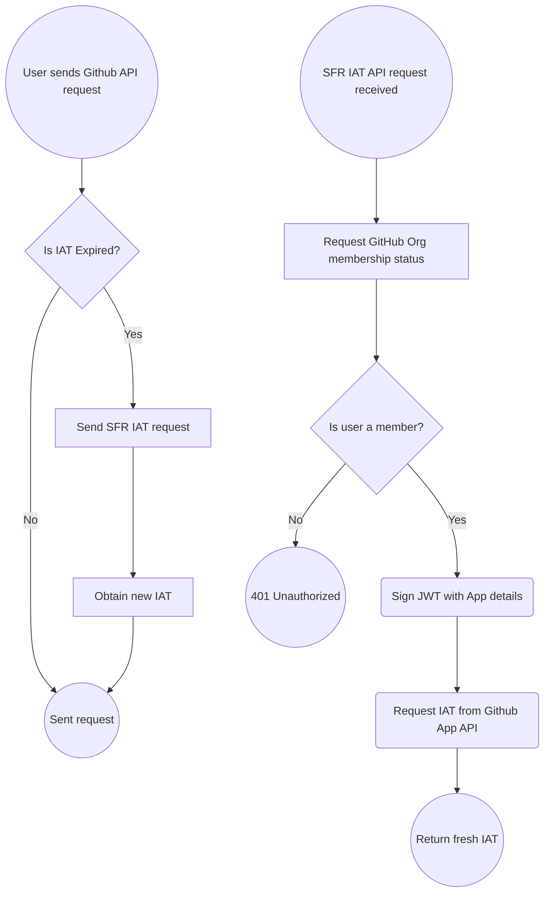

# SFR IAT API
This is an ultra-lightweight FastAPI service to dispense Github Installation Access Tokens to plugin users. The API is to avoid distibuting sensitive PEMs across the team.

You could in theory use a user's PAT to authenticate with the Github API instead of an IAT, but good luck instructing a dozen freshers on how to do that! Accessing the Github API on behalf of an App with strict permissions is safer and we can track plugin usage among the team.

## How is it deployed?
The app is deployed with Google Cloud Run (GCR). It scales to 0 workers when its' dormant, and up to 1 during heavy periods using the built-in autoscaling feature. 
- It's assigned 1 vCPU and 128 MiB
- Billed per-request. 
- Request timeout is set to 15s (typical response time using google infra is ~500ms).
- It can accept 15 concurrent requests. 

Due to the bursty nature of requests (1 request per-user per-hour), it's highly unlikley these limits will ever be hit, at least with the predicted electronics team size this year.

The deployment can sustain 40 users 24/7 and costs less than 0.01 USD per month.

## How does it work?
It's a Python FastAPI app, with rate-limit throttling from SlowAPI.
Upon recieving a request:
- GCR scales workers to 1 and the request is handed to FastAPI.
- The API accepts a Github API User token and authenticates on behalf of the user.
- It fetches their membership status of the sheffracing org.
-  A JWT is signed with the Github App's details
- Requests a new IAT from the Github App API



# Install instructions
> [!IMPORTANT]
> Automatic deployment is not set up due to security. For new builds, contact @onmort

### Enviroment Variables
The API uses Enviroment Variables for all secrets (Using Secrets Manager API during deployment) and variables that may change after deployment. They are as follows:
- `INSTALLATION_ID` - The Unique ID that Github assigns to a Github App install.
-  `CLIENT_ID` - The client ID assigned to the Github App.
- `ORG` - Our Organisation slug, set to `sheffracing`.
- `APP_KEY_SECRET` - The App's private key.

When testing locally, you will need to set these manually, a `.env` file is recommended.
## MacOS
1. Install [Homebrew](https://brew.sh) if you haven't already by running this command in Terminal:

    ```
    /bin/bash -c "$(curl -fsSL https://raw.githubusercontent.com/Homebrew/install/  HEAD/install.sh)"
    ```
    You may need to restart after installing Homebrew.
2. Install [Docker via Homebrew](https://formulae.brew.sh/formula/docker):
    ```
    brew install docker
    ```

3. Download Docker Desktop [here](https://docs.docker.com/desktop/setup/install/mac-install/).

4. Open Terminal (VS Code recomended) in this repo's /app directory
5. Build the docker container:
    ```
    docker build -t sfr-iat-api .
    ```
6. Run the docker container:
    ```
    docker run --rm -p 8080:8080 sfr-iat-api
    ```
    This will run the FastAPI app on http://localhost:8080

7. Verify the API is up by viewing the Swagger UI docs at http://localhost:8080/docs

## Windows
1. Download Docker Desktop [here](https://docs.docker.com/desktop/setup/install/windows-install).
2. Open Terminal (VS Code recomended) in this repo's /app directory
3. Build the docker container:
    ```
    docker build -t sfr-iat-api .
    ```
4. Run the docker container:
    ```
    docker run --rm -p 8080:8080 sfr-iat-api
    ```
    This will run the FastAPI app on http://localhost:8080

5. Verify the API is up by viewing the Swagger UI docs at http://localhost:8080/docs